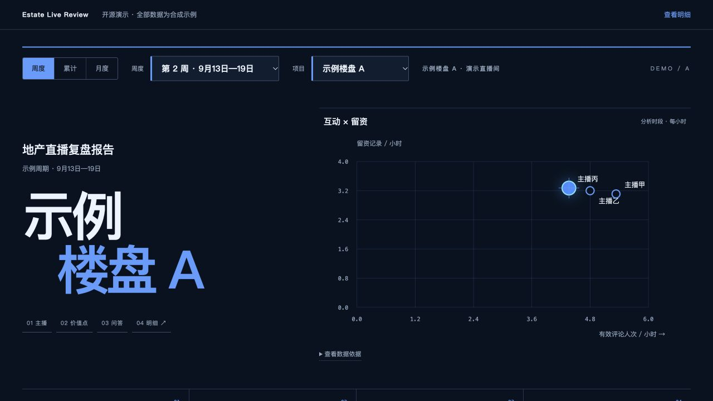

# Estate Live Review · 房产直播分析系统

从实际地产直播复盘流程中整理的开源工具：以主播为单位连接录音、转写、客户问题、真实答法和留资结果，提供科技蓝网页报告、Python 分析工具和助手插件。

[](https://github.com/joechan0410/estate-live-review/actions/workflows/ci.yml)
[](LICENSE)



## 快速运行网页

需要 Node.js **22.12+**：

```sh
git clone https://github.com/joechan0410/estate-live-review.git
cd estate-live-review/web
npm ci
npm run dev
```

打开终端显示的地址。网页自带三组示例楼盘、主播和两周合成数据，启动演示无需 API Key。

```sh
npm test
npm run build
npm run preview
```

构建结果位于 `web/dist/`，可部署到静态网站服务。

## 可以做什么

- **按主播复盘**：七项评分、贡献、评级、优缺点和证据录音。
- **查看客户问题与答法**：主题频次、真实回答、去重样本和后续留资表现。
- **合并周期**：周度、累计、月度与多项目切换，按原始计数和时长汇总。
- **处理录音与转写**：HLS 采集、字幕整理、术语候选、静默区间分析、本地 ASR 补转及 MP3 归档。
- **作为助手插件使用**：工作区定位、依赖检查、分析流程和报告构建入口。

网页样例仅用于演示界面和数据结构。自己的媒体、转写和客户资料放入个人工作区，通过所需 CLI 处理并映射到页面数据契约。

## 七项评分

| 指标 | 默认权重 |
| --- | ---: |
| 留资效率 | 25% |
| 互动 | 11% |
| 评论后留资 | 16% |
| 价值讲透 | 5% |
| 表达组织 | 11% |
| 小风车引导 | 16% |
| 静默控制 | 16% |

配置见 [`pipeline/assets/scoring-policy.json`](pipeline/assets/scoring-policy.json)。缺测项保留缺测状态；实际主播身份、交接和内容语义评分接收上游审核结果。

## Python 工具

基础转写整理、评分和单元测试使用 Python **3.11+** 标准库：

```sh
python3 -m unittest discover -s tests -v
python3 -m pipeline.score_hosts \
  --input tests/fixtures/synthetic-hosts.json \
  --output /tmp/synthetic-host-scores.json
```

| 模块 | 用途 |
| --- | --- |
| `pipeline.collect_media` | 采集已提供的 HLS 回放和字幕 |
| `pipeline.process_transcripts` | 整理已有字幕、ASR、术语与行动提示候选 |
| `pipeline.analyze_audio` | VAD 静默分析与匿名说话人候选 |
| `pipeline.transcribe_missing` | Apple Silicon 上的 MLX 本地缺口补转 |
| `pipeline.archive_audio` | 生成并验证 MP3 归档 |
| `pipeline.score_hosts` | 根据审核后的计数、时长及量表计算七项评级 |
| `pipeline.attribute_comment_leads` | 按实际当班及末次前序评论连接客户留资，输出归属、去重与机会记录 |

媒体工具按需安装 [`pipeline/requirements.txt`](pipeline/requirements.txt)，并在 PATH 中提供 FFmpeg/ffprobe。声学模型与 ASR 分别使用 `requirements-audio.txt`、`requirements-asr.txt`；参数与输入目录结构见 [使用说明](docs/usage.md)。

## 目录

```text
web/         独立 React/Vite 报告、合成示例与演示音频
pipeline/    Python 通用分析工具与评分配置
plugin/      Agent Plugins 格式的技能与独立工具副本
tests/       合成输入与后端测试
docs/        使用、结构及贡献说明
.github/     持续集成
```

## 插件

将 [`plugin/`](plugin/) 作为完整本地插件目录载入支持 Agent Plugins 的客户端。也可以在仓库根目录检查及构建：

```sh
python3 plugin/skills/estate-live-workbench/scripts/workspace.py \
  --workspace . --check-dependencies
python3 plugin/skills/estate-live-workbench/scripts/report_build.py \
  --project-dir web --run
```

网页使用独立 React 运行环境；插件可连接本仓库，也可连接已有的分析工作区。详见 [插件说明](plugin/README.md)。

## 开发与数据接入

- [使用与输入结构](docs/usage.md)
- [系统结构](docs/architecture.md)
- [贡献说明](docs/CONTRIBUTING.md)
- 页面数据示例：[`web/src/demo-data.js`](web/src/demo-data.js)

GitHub Actions 执行 Python 测试、网页数据契约测试和生产构建。

## 许可证

项目源码采用 [MIT](LICENSE)。依赖和可选模型说明见 [第三方声明](THIRD_PARTY_NOTICES.md)。
